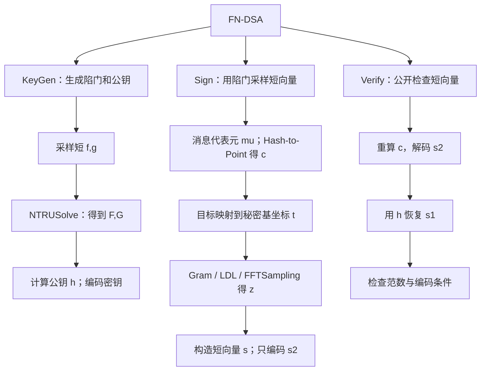
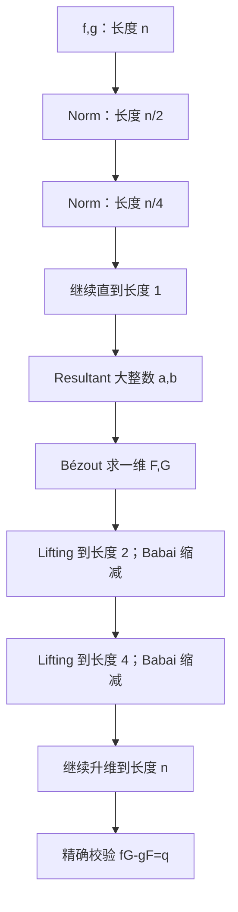
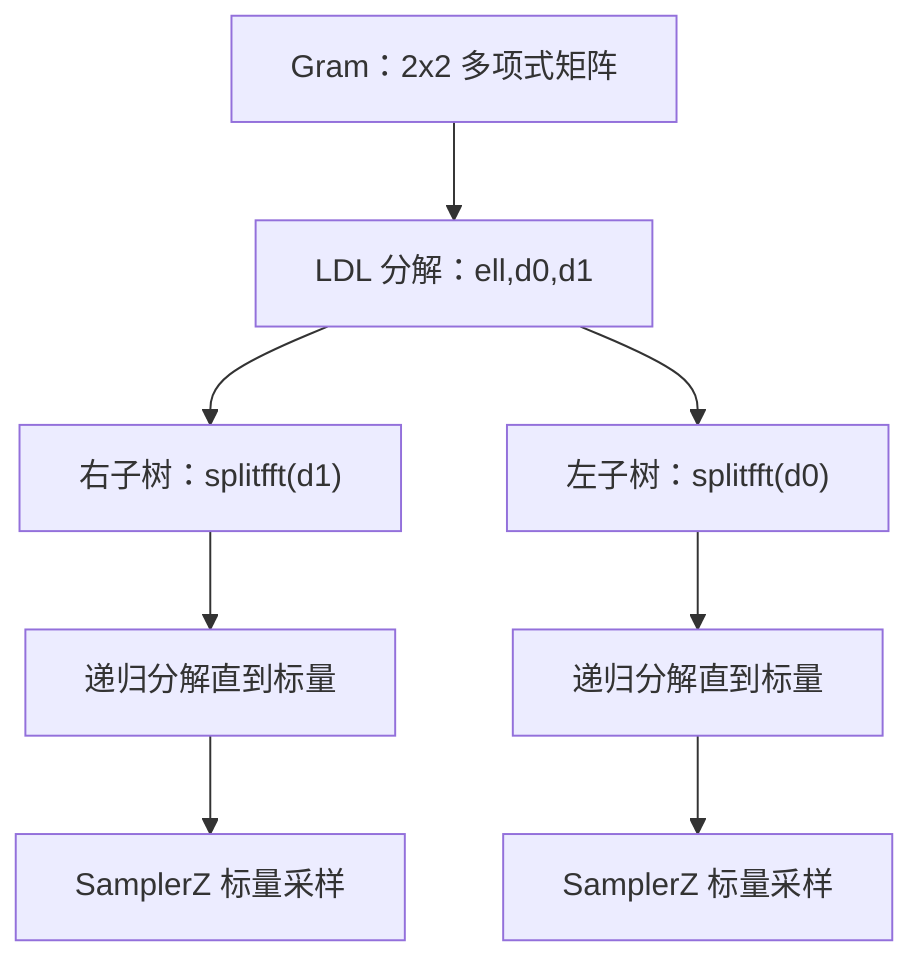
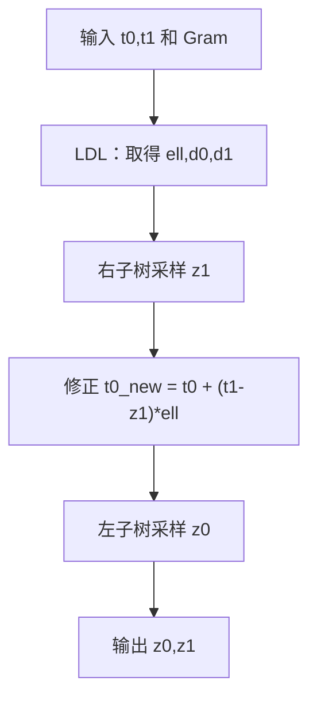
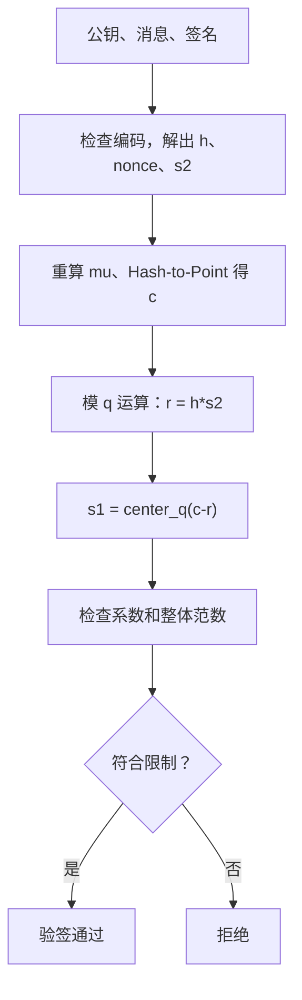

# FN-DSA：从 KeyGen、Sign、Verify 到 C-FN-DSA 定点版本的算法笔记

> 更新：2026-10-19。以 [c-fn-dsa](https://github.com/pornin/c-fn-dsa)、[c-fn-dsa-alt](https://github.com/pornin/c-fn-dsa-alt)、[c-fn-dsa-fx32.64](https://github.com/pornin/c-fn-dsa-fx32.64) 为源码参照。版本均以查看时的 `main` 分支为准，仓库更新可能导致位置变化。
>
> 阅读路径：**符号表 → 顶层算法树 → KeyGen（按实际阶段向下）→ Sign（按实际阶段向下）→ Verify → 定点版本对照 → 代码调用树与函数索引**。底层 NTT、RNS/CRT、FFT 只在对应算法需要时解释。公式采用 GitHub 支持的 `math` 代码围栏；流程图节点使用带引号的标签。
>
> 状态边界：2026-10-19 时 FN-DSA 的 FIPS 206 最终规范尚未发布。这里的 2026 年代码、NIST 邮件与实验性实现必须与正式标准区分。**示例中的 `n=2/4`、`q=7/17` 只说明计算，不代表安全参数**。

## 0. 符号表与术语

| 符号 | 作用 | 首次出现位置 |
|---|---|---|
| `n=2^logn` | 多项式系数个数，正式参数取 512 或 1024 | KeyGen |
| `q=12289` | FN-DSA 的公钥模数 | KeyGen |
| `R=Z[X]/(X^n+1)` | 负循环整数多项式环 | KeyGen |
| `R_q=R/qR` | 系数模 `q` 后的环 | KeyGen / Verify |
| `f,g` | KeyGen 采样的两个短多项式 | KeyGen |
| `F,G` | NTRUSolve 解出的短多项式 | KeyGen |
| `h` | 公钥，`h=g/f (mod q)` | KeyGen |
| `B` | 私密 NTRU 格基，两行为 `(g,-f)` 与 `(G,-F)` | KeyGen / Sign |
| `c` | Hash-to-Point 输出的目标多项式 | Sign |
| `u=(c,0)` | 公钥约束对应的目标向量 | Sign |
| `t=uB^{-1}` | 目标在秘密基下的实数坐标 | Sign |
| `z=(z0,z1)` | FFTSampling 得到的整数坐标 | Sign |
| `s=(s1,s2)` | 短签名向量，`s=u-zB` | Sign / Verify |
| `mu` | 从待签输入、公钥绑定及上下文生成的 64 字节代表元 | Sign / Verify |
| `nonce` | 40 字节公开随机值 | Sign / Verify |
| `Norm` | 递归降维操作，注意与向量二范数区别 | KeyGen / Solve |
| `Res` | 结式，即递归到 1 维时得到的整数 | Solve |
| `RNS`、`CRT` | 多模表示、由多模结果重建大整数 | Solve |
| `NTT` | 有限域上的精确多项式变换 | Solve / Verify |
| `FFT` | 复数域上的近似多项式变换 | Solve / Sign |
| `Gram`、`LDL` | 格基几何信息、条件高斯分解 | Sign |
| `fpr` | `c-fn-dsa` 中的 binary64 实数表示 | 版本对照 |
| `rx` | `c-fn-dsa-fx32.64` 中的 96 位 32.64 定点表示 | 版本对照 |

本文采用**行向量约定**。`a*` 表示共轭或伴随，`B*` 表示共轭转置；多项式的伴随在环中写为 `a(X^{-1})`，其 FFT 槽表现为复共轭。整数环中的等式与模 `q` 同余必须分开阅读。

## 1. 先看整体：FN-DSA 解决什么问题

FN-DSA 是 Falcon 路线的基于 NTRU 格陷门的数字签名。一个公开多项式 `h` 决定一组同余关系。**验签者只需判断签名是否满足同余且足够短；签名者则借助秘密短基，快速产生满足要求的短向量。**



三个过程共享两个核心等式。

**密钥生成必须求解：**

```math
fG-gF=q\quad\text{in }R.
```

**签名必须满足：**

```math
s_1+s_2h\equiv c\pmod q,\qquad
\|s_1\|_2^2+\|s_2\|_2^2\leq\beta^2.
```

前一式是整数环里的**精确 NTRU 方程**，后一式是模 `q` 同余和短向量条件。`F,G` 的求解最复杂；`Sign` 的高斯采样最具代表性；`Verify` 相对直接。

### 1.1 一次签名中实际保存什么

- 私钥的数学核心是 `f,g,F,G`；当前 C 编码可以压缩保存 `f,g,F`，在签名时由 NTRU 方程恢复 `G`，并包含相应版本所需元数据及公钥哈希。
- 公钥只有 `h` 的编码表示。2026-07 的 C 实现采用 NTT 域公钥编码，不能与早期 Falcon 的系数域编码混同。
- 签名不需要同时编码 `(s1,s2)`。输入 `h,c,s2` 已足以重新计算 `s1`，因此主要保存 `nonce` 和 `s2` 的压缩编码。

### 1.2 为什么整个过程分成 KeyGen 和 Sign 两种不同数值任务

KeyGen 中 NTRU 方程必须精确成立，存在数千位中间整数，需要 RNS、CRT、多精度整数、NTT。Sign 中要把目标点映射到某个**概率分布**上的近邻格点，需要 FFT、Gram/LDL 和近似实数运算。两者都能使用整数指令，但前者核心是精确整数，后者核心是**用整数编码实数**。这正是 32.64 定点改造集中发生在 Sign 的原因。

---

# 第一部分：KeyGen，从短多项式到 NTRU 陷门

## 2. KeyGen 顶层阶段

```text
KeyGen(logn, random)
 ├── 生成秘密候选 f、g（离散高斯）
 ├── 检查 f、g 是否满足可逆性和长度约束
 ├── NTRUSolve(f,g)
 │    ├── Norm 递归：n → n/2 → ... → 1
 │    ├── 得到深层 Resultant 整数
 │    ├── 扩展 BGCD / Bézout：求最深层 F、G
 │    └── 自底向上逐层恢复
 │         ├── Lifting：重建更高维精确解
 │         └── Babai Reduction：缩短 F、G
 ├── 检查 fG-gF=q 与 F、G 系数界
 ├── 计算 h=g/f (mod q)
 └── 编码签名密钥和验证密钥
```

函数入口可对应 `kgen.c`，递归 Solve 对应 `kgen_ntru.c`。先理解每一步的数学目的，再看代码复用缓冲区的细节。

## 3. 为什么 KeyGen 要构造 NTRU 格

### 3.1 负循环多项式环

```math
R=\mathbb{Z}[X]/(X^n+1),\qquad R_q=(\mathbb{Z}/q\mathbb{Z})[X]/(X^n+1).
```

在 `R` 中 `X^n=-1`。例如 `n=4` 时：

```math
X^4=-1,\qquad X^5=-X.
```

计算 `(1+X^3)(1+2X)` 的乘积：

```math
(1+X^3)(1+2X)=1+2X+X^3+2X^4
=-1+2X+X^3.
```

超出最高项后的系数带负号折回，称为**负循环卷积**。与普通 `X^n-1` 的循环卷积不同，NTRU 计算和下面的 NTT 都必须处理这个负号。

### 3.2 公钥 h 与格的关系

先取短 `f,g`，要求 `f` 在 `R_q` 内可逆：

```math
h=gf^{-1}\pmod q,\qquad fh\equiv g\pmod q.
```

公钥定义一组格向量：

```math
\mathcal{L}_h=\{(a,b)\in R^2:a+bh\equiv0\pmod q\}.
```

密钥生成另外找 `F,G` 满足：

```math
fG-gF=q.
```

构造秘密基：

```math
B=\begin{pmatrix}
g & -f \\
G & -F
\end{pmatrix},\qquad
\det B=fG-gF=q.
```

因为 `g-fh≡0` 且 `G-Fh≡0 (mod q)`，`B` 的两行都属于 `\mathcal{L}_h`。行列式关系使它们构成所需的完整 NTRU 格基，而非仅仅是两个任意同余解。基向量系数短、Gram 性质好，才能支持高效近邻采样。

**二维直观例子**：在普通整数上取 `f=2, g=1, q=7`，任选 `F=1,G=4`，则 `fG-gF=8-1=7`。

```math
B=\begin{pmatrix}
1 & -2 \\
4 & -1
\end{pmatrix},\qquad \det B=7.
```

公钥是 `h=g/f=1\cdot2^{-1}=4 (mod 7)`。第一行 `(1,-2)` 验证 `1-2·4=-7≡0 (mod 7)`；第二行 `(4,-1)` 验证 `4-4=0`。签名阶段将利用这种短基结构。这个二维例子不是实际 FN-DSA 密钥。

## 4. KeyGen 第一步：短多项式 f、g 与拒绝条件

`f,g` 的系数来自给定宽度的离散高斯采样，并非对每个系数均匀选择 `[-127,127]`。抽到候选后检查多种限制，避免不合适的格基：

1. `f` 必须在 `R_q` 可逆，否则 `h=g/f` 不存在。实际可在模 `q` 的 NTT 表示下检查各槽是否非零。
2. `f,g` 的范数、相关正交化质量要满足签名用的几何条件；仅有短系数并不足够。
3. 递归 Solve 可能失败，例如深层 resultant 不互素或求出的 `F,G` 过大。这种情况下丢弃候选并重新采样。

由此可区分 **输入采样失败**、**公钥可逆性失败**、**NTRUSolve 失败**，它们的数学原因不同。私钥必须满足精确方程并符合规定系数范围，而不是只要 `g/f` 可求就接受。

## 5. KeyGen 第二步：NTRUSolve 的递归降维

### 5.1 Solve 在解什么

原方程：

```math
f(X)G(X)-g(X)F(X)=q\quad\text{in }\mathbb{Z}[X]/(X^n+1).
```

直接在 `n=1024` 下用扩展欧几里得求多项式解并控制系数尺寸并不容易。FN-DSA 改用分治：把两个多项式逐层变成更低维多项式，直到只剩两个大整数；一维求解后，再逐层升回原维度。



### 5.2 Norm 为什么能降维

设 `n` 是偶数，将多项式写成偶次项和奇次项：

```math
f(X)=f_0(X^2)+Xf_1(X^2).
```

把 `X` 换成 `-X`：

```math
f(-X)=f_0(X^2)-Xf_1(X^2).
```

相乘：

```math
\begin{aligned}
f(X)f(-X)
&=f_0(X^2)^2-X^2 f_1(X^2)^2\\
&=\mathrm{Norm}(f)(X^2).
\end{aligned}
```

结果只包含偶次幂。以 `Y=X^2` 代替，便得到长度 `n/2` 的多项式。对 `g` 做同样操作。

**可以手算的 `n=2` 例子**：

```math
f(X)=1+X,\quad g(X)=1,\quad X^2=-1.
```

```math
\mathrm{Norm}(f)=(1+X)(1-X)=1-X^2=2,
\qquad \mathrm{Norm}(g)=1.
```

`(1+X,1)` 由两个一次多项式降为整数 `(2,1)`。原本求两个多项式 `F,G` 的问题，最深层变成求两个整数的 Bézout 系数。

### 5.3 为什么降维后系数越来越大

Norm 包含多项式相乘。系数数目从 `n` 降到 `n/2`，但系数的绝对值、位长可能增长。继续降到 `n=1`，得到的 `Res(f,X^n+1)` 和 `Res(g,X^n+1)` 可能是几千位的大整数。这解释了为什么代码不能只依靠 `int64_t`。

`Norm` 是这里的**代数范数**，不是下文检查签名长度所用的欧氏范数。

### 5.4 Solve 内为什么需要 RNS、NTT 和 CRT

降维中的多项式乘法以及后续升维必须**精确**，直接做超大整数的每次卷积代价高。源码在若干 31 位素数模数下执行多项式运算，最后重建整数：

```text
大系数多项式
  ├── 对 p0 取模 → NTT → 点乘 → iNTT
  ├── 对 p1 取模 → NTT → 点乘 → iNTT
  ├── 对 p2 取模 → NTT → 点乘 → iNTT
  └── ...
        ↓
     CRT 重建整数系数
```

RNS 是同一大整数在不同素数下的余数表示；NTT 是每个素数下的快速卷积工具；CRT 从多模结果恢复原始整数。三者不是同一种算法，也不能用 FFT 的近似结果直接替代精确重建。

**NTT 小例子**：取教学参数 `n=4,p=17`。`2^4=16≡-1 (mod 17)`，故 `psi=2` 可充当负循环变换的 8 次单位根；`psi` 的奇数次幂是 4 个求值点 `2,8,15,9`。设 `a(X)=1+2X`：

| 代入点 | `a(point) mod 17` |
|---:|---:|
| 2 | 5 |
| 8 | 0 |
| 15 | 14 |
| 9 | 2 |

在这 4 个点上分别相乘，再逆变换，即得到 `mod (17,X^4+1)` 的多项式乘积。真实实现通常采用蝶形 NTT，不直接写四个多项式求值循环。

**CRT 小例子**：整数 `x=-5`，模 `17` 的余数是 `12`，模 `19` 的余数是 `14`。CRT 在模 `323` 下得到 `318`；按有符号居中表示转换得到 `318-323=-5`。只要模数乘积覆盖被重建整数的范围，便可**精确**恢复，而不是浮点近似。

**容易混淆的两个 `p`**：KeyGen RNS 使用一组实现挑选的 31 位素数 `p_i`；Verify/公钥运算的模数始终是 `q=12289`。两组 NTT 的模数、常数和语义不同。`31-bit limb` 是大整数储存的位宽约定，也不是 NTT 素数的数学定义。

## 6. KeyGen 第三步：最深层扩展 BGCD / Bézout

降到 1 维后，目标变成：

```math
aG-bF=q,\qquad
a=\mathrm{Res}(f,X^n+1),\quad b=\mathrm{Res}(g,X^n+1).
```

先计算满足 `au-bv=1` 的整数系数，再乘 `q`；需要 `gcd(a,b)=1`。如果不互素，这组候选通常被拒绝。

**继续上一节的 `n=2` 例子**：`a=2,b=1,q=7`，取 `G'=3,F'=-1`：

```math
2\cdot3-1\cdot(-1)=7.
```

一维解已经得到，下一步才升回多项式。

### 6.1 普通 GCD 与这里的扩展 BGCD

- 普通 Euclid / Binary GCD 的输出是 `gcd(a,b)`。
- 扩展 Euclid / Extended Binary GCD 除了 GCD 还要计算 Bézout 系数，即 `au-bv=gcd(a,b)`。
- C-FN-DSA 的 `zint_bezout` 是经过批处理的扩展二进制 GCD：先根据高低位估计一批二进制更新，累计 2×2 变换矩阵，再对完整多 limb 整数执行 co-reduction。不是把标准库的 `gcd` 返回值直接当作 `F,G`。

**为什么保留矩阵形式**：每次对 6000 位整数执行一次完整右移/减法很贵；用一批短整数状态推演约几十步，再应用一次矩阵，大幅减少全宽扫描次数。处理时仍需要满足系数范围、进位与循环次数要求。它与 Bernstein–Yang `divsteps` 有思想联系，但不应视为同一份直接实现。

## 7. KeyGen 第四步：Lifting 逐层升维

设当前高一层的 `f,g` 已知，低一层满足：

```math
f'(Y)G'(Y)-g'(Y)F'(Y)=q,
\quad f'(X^2)=f(X)f(-X),\quad g'(X^2)=g(X)g(-X).
```

定义升维解：

```math
F(X)=F'(X^2)g(-X),\qquad
G(X)=G'(X^2)f(-X).
```

代入：

```math
\begin{aligned}
fG-gF
&=f(X)f(-X)G'(X^2)-g(X)g(-X)F'(X^2)\\
&=f'(X^2)G'(X^2)-g'(X^2)F'(X^2)\\
&=q.
\end{aligned}
```

这是 Lifting 最重要的性质：**升维后仍满足整数环中的精确 NTRU 方程**。不过升维后的 `F,G` 可能非常大，需要下一阶段约减。

**接续手算例子**：`f=1+X,g=1,q=7`，一维 `F'=-1,G'=3`。代回：

```math
F=-1\cdot g(-X)=-1,
\qquad G=3\cdot f(-X)=3(1-X).
```

```math
(1+X)\,3(1-X)-1\cdot(-1)=3(1-X^2)+1=7.
```

因此 `(F,G)=(-1,3-3X)` 是一个合法 NTRU 方程解。此处 `q=7,n=2` 只是展示 **Norm → Bézout → Lifting** 可接起来执行。

## 8. KeyGen 第五步：Babai Reduction 缩短 F、G

Lifting 只负责可解性，不负责短。利用方程解的非唯一性，选择整数多项式 `k` 更新：

```math
F\leftarrow F-kf,\qquad G\leftarrow G-kg.
```

由于交叉项相消：

```math
f(G-kg)-g(F-kf)=fG-gF=q.
```

所以不会破坏精确 NTRU 方程。如何选 `k`？将 `(F,G)` 朝 `(f,g)` 方向投影，得到近似投影商：

```math
k\approx\mathrm{round}\left(
\frac{Ff^{\ast}+Gg^{\ast}}{ff^{\ast}+gg^{\ast}}
\right).
```

上式是数学记号；GitHub 可用的等价文字是“逐 FFT 槽做复数除法、逆变换、舍入为整数多项式”。真实实现因数值范围与误差界采用定点 FFT 和缩放策略，不是直接用一条表达式完成。投影只是**近似估计 `k`**，随后对大整数系数执行的 `F-kf`、`G-kg` 必须精确。

**普通整数类比**：`f=2,g=1,q=7`，如果 Lifting 后得到 `F=101,G=54`，则 `2·54-101=7`。取 `k=50`：

```math
F'=101-50\cdot2=1,\qquad G'=54-50\cdot1=4.
```

新解 `2·4-1=7` 仍成立，但大小明显下降。真正的 Babai Reduction 在每个多项式系数槽计算投影，并进行多轮修正。

### 8.1 KeyGen 为什么也会出现定点计算

投影公式需要比值、复共轭和近似取整；这里存在 32.32 类型的定点运算。但参与 Norm、Bézout、CRT 的精确数值仍是普通多精度整数。这一区分在阅读 `kgen_fxp.c` 与 `kgen_zint31.c` 时尤为重要：文件名中的 fxp 不意味着整个 KeyGen 都变成定点数。

## 9. KeyGen 收尾：校验、构造 h、编码

逐层恢复结束后检查 `fG-gF=q`、`F,G` 合法范围，计算 `h=g/f (mod q)`。公钥计算属于 `R_q` 中的除法，可通过 NTT 槽中的模逆运算完成。此时不需要 Sign 的 FFT 近似浮点。

密钥打包时的编码格式也是算法版本的一部分。2026 年 C 版本加入公钥哈希相关存储并将公钥定义为 NTT 编码形式；与早期 Falcon 的二进制密钥不能仅凭相同的 `n,q` 就认为兼容。

---
# 第二部分：Sign，从消息多项式到短签名

## 10. Sign 总调用逻辑

```text
Sign(sk, context, message, randomness)
 ├── 解码私钥并恢复签名所需的秘密基 f,g,F,G
 ├── 构造 64 字节 mu：绑定公钥、消息类型和上下文
 └── 签名尝试（可能重复）
      ├── 生成 40 字节 nonce
      ├── Hash-to-Point(nonce,mu) → 多项式 c
      ├── 将目标 u=(c,0) 变为秘密基坐标 t=u B^(-1)
      ├── Gram：计算 B B*；执行 LDL / ffLDL
      ├── FFTSampling(t,Gram)
      │    ├── 按 LDL 关系，先抽样 z1
      │    ├── 用 z1 修正 t0
      │    ├── 再抽样 z0
      │    └── 最深层调用 SamplerZ / BaseSampler / BerExp
      ├── 用 z 恢复 s=u-zB，得到 s1,s2
      ├── 检查范数、系数界、可编码性
      └── 合格则编码 (nonce,s2)，否则重试
```

KeyGen 输出的是**求近邻的陷门**，Sign 用它解决：已知目标 `u=(c,0)`，求一个同属于目标同余类、但长度短的整数向量 `s`。以下按执行顺序解释，暂不讨论 `fpr` 与 `rx` 的具体实现差异，数值版本留到后面单独对照。

## 11. Sign 第一步：消息代表元 mu

早期 Falcon 容易写成 `Hash(nonce || message)`；2026 年 `c-fn-dsa` 已不是这条路径。当前实现先计算一个固定 64 字节的 `mu`，使输入携带公钥绑定、上下文与消息模式等信息。签名和验签需使用完全相同的构造。

可以将输入关系概括为：

```text
验证密钥 vk ──SHAKE256──> 64-byte H(vk)
用户上下文、消息或预哈希标识 ──┐
H(vk) ──────────────────────────┼──> compute_mu ──> 64-byte mu
消息内容（或预哈希内容）─────────┘
```

`mu` 不是最终用于格签名的系数多项式，而是固定长度字节串。它把消息处理与后续重复执行 Hash-to-Point 的成本分离开：同一份 `mu` 下，重新生成 `nonce` 即可重新生成一个目标 `c`。在 Verify 端也能重算 `mu`。

具体 `mu` 串接格式、上下文边界和消息类型标识应以 `fndsa.h` 和 `sign.c` 的对应版本为准，不应把上面的数据流简写成未经确认的逐字节串接公式。

## 12. Sign 第二步：Hash-to-Point，得到 c

### 12.1 为什么不能把 2 字节随机数直接模 q

Hash-to-Point 的目标是让每个系数尽量均匀地分布于 `0,...,q-1`。SHAKE256 先从 `nonce || mu` 产生伪随机字节流，按**小端**拼成 16 位候选 `w`：

```math
w=b_0+2^8b_1,\qquad 0\leq w<65536.
```

因为 `65536` 不是 `12289` 的整数倍，直接用 `w % q`，某些余数对应 6 个候选，其他只对应 5 个，产生模偏差。取：

```math
5q=5\cdot12289=61445.
```

仅接受 `w<61445`，此范围刚好包含五组完整的 `0,...,q-1`；接受后再做 `w mod q`，即可得到严格均匀的系数。

```text
SHAKE256(nonce || mu)
   ↓ 每次取两个字节 b0,b1（小端）
w = b0 + 256*b1
   ├── w >= 61445 ：丢弃，继续取下一组
   └── w <  61445 ：c[i] = w % 12289，i++
                 ↓
           收集 n 个系数
```

**候选示例**：`w=12345`，由于小于 `61445`，接受后得到 `c[i]=12345-12289=56`。若候选 `w=62000`，即使 `62000%12289` 可以计算，也必须丢弃，否则破坏均匀性。`w=61444` 可接受，`w=61445` 必须拒绝。

### 12.2 一次 Hash-to-Point 生成的是向量，不是标量摘要

得到 `n` 个系数后构成：

```math
c(X)=c_0+c_1X+\cdots+c_{n-1}X^{n-1}\in R_q.
```

Hash-to-Point 输出的 `c` 本身不要求短。真正要短的是签名向量 `(s1,s2)`。目标 `c` 的系数若接近 `q`，不会妨碍格签名，因为签名者要找的是满足模 `q` 同余的短解。

### 12.3 为什么 nonce 可以公开

签名的随机性参与目标多项式生成；发布 `nonce` 使 Verify 能重算同一个 `c`。nonce 本身不是私钥。安全要求来自采样分布、随机源及实现行为，不是把 nonce 保密。

## 13. Sign 第三步：从目标 u 到秘密基坐标 t

### 13.1 直接对 c 取短向量为什么困难

需要求：

```math
s_1+s_2h\equiv c\pmod q.
```

如果随便取 `s2=0`，则 `s1=c`，同余成立，但居中后的范数通常过大。公钥定义的格让验签很简单，却不提供求最短向量的捷径。KeyGen 生成的秘密基 `B` 是专门用来解决这个搜索问题的。

### 13.2 最近格点问题

令：

```math
u=(c,0),\qquad
B=\begin{pmatrix}
g & -f\\
G & -F
\end{pmatrix}.
```

任取整数多项式坐标 `z=(z0,z1)`，`zB` 都属于核格 `\mathcal L_h`。因此

```math
s=u-zB
```

必然满足：

```math
s_1+s_2h\equiv c\pmod q.
```

剩下的困难只有一个：如何选 `z`，使 `s` 很短并具有规定的概率分布。

将目标转换为秘密基坐标：

```math
t=uB^{-1}.
```

由 `det(B)=q` 得：

```math
B^{-1}=\frac1q\begin{pmatrix}
-F & f\\
-G & g
\end{pmatrix}.
```

故：

```math
t=\left(-\frac{cF}{q},\frac{cf}{q}\right).
```

这里的除法和多项式乘法在实数/复数嵌入下理解，实际在 FFT 表示中计算。`t` 一般不是整数坐标，因此不能简单把它复制到 `z`。

### 13.3 一维类比

令普通实数目标 `t=3.4`、基底向量长度为 2，则格点只有 `...,0,2,4,6,...`。确定性的最近整数选择可能返回 4，但密码学采样不能每次硬返回同一个最近点，否则输出统计分布可能反映私钥几何结构。FN-DSA 使用随机高斯采样，并以短范数条件筛掉不合适的结果。

## 14. Sign 第四步：FFT 和 Gram，描述目标距离

### 14.1 Sign 用 FFT 的目的与 KeyGen 的 NTT 不同

Sign 需要大量近似实数多项式运算：共轭、内积、除法、平方根和目标投影。在 `R` 的复数嵌入中，负循环多项式可在 `X^n+1` 的复根处求值，卷积转成逐槽乘法。

在 `n=4` 的教学例子中，`X^4=-1` 的复根可写为：

```math
\zeta_k=\exp\left(\frac{(2k+1)\pi i}{4}\right),\qquad k=0,1,2,3.
```

`FFT(a)` 是 `a(\zeta_k)` 的组合表示。对每个复数槽的矩阵计算可以并行进行，最后 iFFT 回到多项式系数。

**与 NTT 的联系及区别**：两者都把卷积变成点乘；NTT 在有限域中计算模整数，无舍入误差；FFT 在复数中计算近似实数，会有舍入误差。Sign 的 `FFTSampling` 是几何与概率问题，不能简单用模 `q` NTT 替代。

### 14.2 Gram 矩阵从哪里来

签名长度：

```math
\|s\|_2^2=\|(t-z)B\|_2^2.
```

展开得到：

```math
\|s\|_2^2=(t-z)\,\mathcal G\,(t-z)^{\ast},\qquad
\mathcal G=BB^{\ast}.
```

`\mathcal G` 是 Gram 矩阵，在每个 FFT 槽中相当于一个 Hermitian 2×2 矩阵。它将秘密基 `B` 的几何伸缩、斜交信息编码成采样时的距离度量。对 FN-DSA 的行基，可以写为：

```math
\mathcal G=\begin{pmatrix}
gg^{\ast}+ff^{\ast} & gG^{\ast}+fF^{\ast}\\
Gg^{\ast}+Ff^{\ast} & GG^{\ast}+FF^{\ast}
\end{pmatrix}.
```

因为第二列同时含负号，交叉项仍为正号。若直接对 `t0,t1` 分别舍入，则等于忽略交叉项，通常无法得到正确采样分布。

### 14.3 用普通二维向量理解 Gram

取教学基：

```math
B=\begin{pmatrix}
2&0\\
1&1
\end{pmatrix},\qquad
\mathcal G=BB^{\mathsf T}
=\begin{pmatrix}
4&2\\
2&2
\end{pmatrix}.
```

设 `\delta_0=t_0-z_0`、`\delta_1=t_1-z_1`，对应平方距离：

```math
\delta\mathcal G\delta^{\mathsf T}
=4\delta_0^2+4\delta_0\delta_1+2\delta_1^2.
```

这里有交叉项 `4 delta0 delta1`。这意味着左、右坐标不是两个独立的一维距离；选定 `z1` 后，最合适的 `z0` 中心也随之改变。

## 15. Sign 第五步：LDL 与 ffLDL，把联合分布拆开

### 15.1 对 Gram 执行 LDL 分解

对 Hermitian 2×2 Gram：

```math
\mathcal G=\begin{pmatrix}
a&b\\
\overline b&c
\end{pmatrix},\qquad a>0,
```

可以写成：

```math
\mathcal G=L D L^{\ast},
\qquad L=\begin{pmatrix}
1&0\\
\ell&1
\end{pmatrix},
\qquad D=\begin{pmatrix}
d_0&0\\
0&d_1
\end{pmatrix},
```

其中：

```math
d_0=a,\qquad
\ell=\frac{\overline b}{a},\qquad
d_1=c-\frac{|b|^2}{a}.
```

对上一节的实数矩阵，`a=4,b=2,c=2`：

```math
\ell=\frac12,\qquad d_0=4,\qquad d_1=2-\frac{2^2}{4}=1.
```

```math
\mathcal G=
\begin{pmatrix}1&0\\1/2&1\end{pmatrix}
\begin{pmatrix}4&0\\0&1\end{pmatrix}
\begin{pmatrix}1&1/2\\0&1\end{pmatrix}.
```

这让距离的联合平方型变成逐坐标的条件表达式，为递归高斯采样提供入口。

### 15.2 LDL 中 L 和 D 各承担什么作用

LDL 不只是将矩阵写成三个矩阵的乘积。它把 Gram 描述的二次型改写为**消除交叉项后的长度权重**。对实对称矩阵而言，若设行向量 `\delta=(\delta_0,\delta_1)`，则：

```math
\mathcal G=L D L^{\mathsf T},\qquad
\delta\mathcal G\delta^{\mathsf T}
=(\delta L)D(\delta L)^{\mathsf T}.
```

两个矩阵的分工如下。

- **`L` 描述坐标之间的相关性，并执行三角剪切变换。** 其非对角系数决定一个坐标的误差如何改变另一个坐标的有效误差，因此在 FFTSampling 中用于更新条件采样中心。`L` 不是正交旋转矩阵。
- **`D` 给变换后的各个坐标赋予长度平方权重。** 对同样大小的坐标偏移，`d` 越大，最终签名范数受到的惩罚越大；相应的高斯采样宽度越小。这里的 `d` 不是长度，而是长度平方型的系数。

取另一个普通二维 Gram 例子：

```math
\mathcal G=\begin{pmatrix}
5&6\\
6&17
\end{pmatrix}.
```

其 LDL 分解为：

```math
L=\begin{pmatrix}
1&0\\
1.2&1
\end{pmatrix},\qquad
D=\begin{pmatrix}
5&0\\
0&9.8
\end{pmatrix},\qquad
\mathcal G=LDL^{\mathsf T}.
```

`L` 对坐标误差的作用为：

```math
(\delta_0,\delta_1)L
=(\delta_0+1.2\delta_1,\ \delta_1).
```

这一步没有简单地旋转坐标轴，而是把第二个方向的误差按比例叠加到第一个方向，属于剪切变换。原二次型：

```math
5\delta_0^2+12\delta_0\delta_1+17\delta_1^2
```

经 LDL 配方后得到：

```math
\delta\mathcal G\delta^{\mathsf T}
=5(\delta_0+1.2\delta_1)^2+9.8\delta_1^2.
```

可以直接看出两个效果：`L` 将原来的交叉项吸收到第一个平方项中；`D` 分别对变换后的两个平方项乘以 `5` 和 `9.8`。例如在变换后的坐标中，第二项偏移 `1` 对范数平方贡献 `9.8`，比第一项偏移 `1` 的贡献 `5` 更大。

**与高斯采样的联系。** 令 `\delta_i=t_i-z_i`，上式可改写为：

```math
5\bigl[t_0+1.2(t_1-z_1)-z_0\bigr]^2
+9.8(t_1-z_1)^2.
```

因此必须先生成右侧整数 `z1`，再以

```math
t_0'=t_0+1.2(t_1-z_1)
```

作为左侧的条件采样中心。例如 `t0=1.2`、`t1=2.7`，右侧采到 `z1=3`，则新中心从 `1.2` 调整为 `0.84`。系数 `1.2` 来自 `L`，不是来自 `D`。

另一方面，若高斯权重采用

```math
\exp\left(-\frac{d(t-z)^2}{2\sigma^2}\right),
```

则这一维对应的尺度是：

```math
\sigma_{\mathrm{leaf}}=\frac{\sigma}{\sqrt d}.
```

以这个例子的两个对角权重计算，可分别得到 `\sigma/\sqrt{5}` 和 `\sigma/\sqrt{9.8}`。从这个意义上说，**`L` 负责改变条件采样中心，`D` 负责确定不同方向的采样宽度**。这描述的是递归采样使用的平方型结构；离散整数格上的实际分布还要考虑归一化与采样误差。

### 15.3 为什么不能把 LDL 当作特征值对角化

对同一个实对称正定 Gram，也可以采用特征值分解：

```math
\mathcal G=Q\Lambda Q^{\mathsf T},\qquad
Q^{\mathsf T}Q=I.
```

`Q` 是正交矩阵，表示欧氏意义下的旋转或反射；`\Lambda` 的对角元素是 Gram 的特征值，表示沿正交主轴的长度平方权重。

LDL 的 `L` 通常不是正交矩阵，而是三角剪切；`D` 也通常**不等于**特征值。以上述 Gram 为例，`D` 的对角元素为 `5, 9.8`，而 Gram 的特征值约为 `2.515, 19.485`。

| 分解方式 | 坐标变换 | 对角矩阵含义 | 在 FN-DSA 中的作用 |
|---|---|---|---|
| 特征值分解 `QΛQᵀ` | 正交旋转或反射 | 正交主轴上的权重 | 便于理解椭圆的主轴方向 |
| LDL 分解 `LDLᵀ` | 三角剪切 | 条件平方型中的权重 | 便于右侧采样、左侧条件中心修正和递归 |

FN-DSA 在 FFT 槽中处理的通常是复数 Hermitian Gram，对应使用 `L^{\ast}` 而不是简单转置。选择 LDL 的原因不是它能直接找出椭圆主轴，而是其三角结构恰好适合将多项式格上的联合高斯采样拆成有依赖顺序的递归子问题。

### 15.4 为什么 ffLDL 还要继续递归

一个 FFT 槽的 2×2 矩阵做完 LDL，并不表示已经获得全部整数多项式系数。FFT 结果仍包含多个频率槽，而签名要求得到**整数系数多项式** `z0,z1`。

对对角多项式 `d0,d1`，执行 `splitfft` 将低维度结构分给子树，继续 LDL；直到叶子相当于一维标量采样。回溯时 `mergefft` 将子结果拼回高维 FFT 表示。



ffLDL 树是采样算法的**数学递归结构**，并不意味着每种实现都必须把整棵树预存在私钥里。`c-fn-dsa` 默认会在签名过程中计算并复用工作空间；定点研究版本也提供过展开密钥/预计算树的途径，两者属于计算时间与内存组织的差异。

## 16. Sign 第六步：FFTSampling，先右后左

### 16.1 采样分布不是简单的 round

理想的格点坐标采样权重可以抽象写成：

```math
\Pr[Z=z]\ \propto\
\exp\left(-\frac{(t-z)\mathcal G(t-z)^{\ast}}{2\sigma^2}\right).
```

`\sigma` 表示整体目标采样尺度。真正实现还有离散化、浮点/定点误差、采样概率校正等细节；上述式子是理解 LDL 条件采样的数学模型。

### 16.2 FFTSampling 的两个递归方向

基于 LDL 的采样顺序：

```text
FFTSampling(t0,t1,Gram)
    计算 Gram 的 LDL：ell,d0,d1

    右侧子问题：
        splitfft(d1), splitfft(t1)
        递归得到 z1 的两部分
        mergefft -> z1

    修正左侧中心：
        t0_new = t0 + (t1 - z1) * ell

    左侧子问题：
        splitfft(d0), splitfft(t0_new)
        递归得到 z0 的两部分
        mergefft -> z0

    return (z0,z1)
```



先选右侧是因为左侧条件中心依赖已经抽到的右侧值。若先给 `z0,z1` 分别取整，再把结果组合，便不再对应这组 Gram 诱导的正确联合分布。

### 16.3 用二维 LDL 真正算一次中心修正

继续使用：

```math
\mathcal G=\begin{pmatrix}4&2\\2&2\end{pmatrix},
\qquad \ell=\frac12,\qquad d_0=4,\qquad d_1=1.
```

取目标 `t=(1.2,2.7)`。假设右侧离散高斯采到 `z1=3`，左侧条件中心：

```math
t_0'=t_0+(t_1-z_1)\ell
=1.2+(2.7-3)\cdot0.5=1.05.
```

因此下一次标量采样要以 **1.05** 而不是原来的 **1.20** 为中心；若右侧采到 `z1=2`，同理：

```math
t_0'=1.2+(2.7-2)\cdot0.5=1.55.
```

同一个 `t0` 因为 `z1` 的结果不同，条件中心从 1.05 变到 1.55。这就是 FFTSampling 最核心的条件依赖。实际算法中每个“标量”仍在递归的 FFT 基础叶子上产生，示例只是把其几何意义画出来。

### 16.4 叶子标准差为什么要用 d

对标量叶子的平方型：

```math
\exp\left(-\frac{d(t-z)^2}{2\sigma^2}\right)
=\exp\left(-\frac{(t-z)^2}{2(\sigma/\sqrt d)^2}\right).
```

可见叶子采样宽度是：

```math
\sigma_{\mathrm{leaf}}=\frac\sigma{\sqrt d}.
```

上一数值例子中 `d0=4,d1=1`，若整体 `sigma=2`，右侧叶子标准差是 2，左侧叶子标准差是 1。两个坐标即使中心相近，抽样离散程度也不相同。代码若保存 `isigma`，它指宽度的倒数，不是 `sigma` 本身。

## 17. Sign 第七步：SamplerZ、BaseSampler、BerExp

FFTSampling 每次到底层，只负责把“中心 `mu_leaf`、标准差 `sigma_leaf`”传给标量采样器。标量采样器负责从离散高斯分布中实际产生一个整数：

```math
\Pr[Z=k]\propto
\exp\left(-\frac{(k-\mu_{\mathrm{leaf}})^2}{2\sigma_{\mathrm{leaf}}^2}\right),\qquad k\in\mathbb Z.
```

### 17.1 简单数值例子

取中心 `mu_leaf=1.3`、宽度 `sigma_leaf=1`。候选 1 和 2 的未归一化权重分别为：

```math
w_1=\exp\left(-\frac{(1-1.3)^2}{2}\right)=\exp(-0.045)\approx0.956,
```

```math
w_2=\exp\left(-\frac{(2-1.3)^2}{2}\right)=\exp(-0.245)\approx0.783.
```

二者都可能出现，但中心更近的整数 1 有更高概率。注意，权重不是绝对概率，必须对所有整数求和归一化。不能将 `round(1.3)=1` 当成离散高斯采样。

### 17.2 为什么先 BaseSampler，再 BerExp

直接为任意实数中心、任意宽度构造无限整数集合的完整 CDF 表不现实。Falcon 采样器将问题拆成两层：

- `BaseSampler`：从固定参数的**半高斯**离散分布生成非负幅度 `z0`。源码通常通过预先计算的累积概率阈值表与随机比特比较实现。
- 候选构造：将中心拆成整数部分和小数部分，根据 `z0` 和随机符号生成围绕中心的候选 `z`。
- `BerExp`：通过指数相关的伯努利拒绝测试，调整固定基础分布为目标中心/宽度的离散高斯。拒绝时重新抽样，而不是强行返回最邻近整数。

用式子理解拒绝采样：若基础提议分布为 `Q(z)`，目标权重为 `P(z)`，需要选择常数 `M`，使：

```math
\Pr[\mathrm{accept}\mid z]=\frac{P(z)}{M Q(z)}\leq1.
```

真实实现会把比值改写成指数和有限随机位操作；这里的 `P,Q` 只是拒绝采样原理，不代表源码中的 `BerExp` 参数恰好就是这个式子。`BaseSampler` 与 `BerExp` 两个部分必须一起读。

### 17.3 Hash-to-Point 也做拒绝采样，但目的不同

| 位置 | 被拒绝的对象 | 为何要拒绝 |
|---|---|---|
| Hash-to-Point | 16 位候选 `w>=61445` | 去掉模 12289 时的偏差 |
| SamplerZ / BerExp | 离散高斯候选整数 | 从易采样的基础分布修正到目标分布 |
| 签名末尾 | 整个 `(s1,s2)` | 防止超范数、系数不合法或编码不满足要求 |

这三种拒绝逻辑位于完全不同的层次。

### 17.4 定点实现为什么必须关心 SamplerZ

从 FFT 到 LDL 再到叶子采样，浮点误差会影响 `mu_leaf` 和标准差；`BerExp` 的数值近似影响候选能否被接受。同一随机流中，只要一次接受/拒绝决策不同，后续消耗的随机字节位置也可能改变。因而定点改造必须同时保证**数值精度、舍入语义、抽样概率与随机流管理**，不能只替换 FFT 数据类型。

## 18. Sign 第八步：从 z 计算签名 s，决定是否重试

采样得到整数多项式坐标：

```math
z=(z_0,z_1),\qquad s=u-zB.
```

展开：

```math
\begin{aligned}
s_1&=c-z_0g-z_1G,\\
s_2&=z_0f+z_1F.
\end{aligned}
```

因为 `fh≡g (mod q)`，且由 NTRU 方程可得 `Fh≡G (mod q)`，于是：

```math
\begin{aligned}
s_1+s_2h
&=c-z_0g-z_1G+(z_0f+z_1F)h\\
&\equiv c\pmod q.
\end{aligned}
```

同余自动成立。接下来检查：

1. 结合完整 `s1,s2` 的欧氏范数平方是否不超过对应参数的阈值。
2. 两部分系数及允许的无限范数界是否满足版本要求。
3. `s2` 是否能被当前规定的压缩编码合法表示，编码是否为规范形式。

若失败，整轮签名尝试被拒绝，重新产生随机目标、继续采样。不是把不合格结果裁剪到边界后直接输出：裁剪可能破坏同余、概率分布或编码规范。

**为什么只需要发出 `s2`**：由 `s1≡c-hs2 (mod q)`，Verify 能把 `s1` 恢复成居中的小整数系数。因此签名输出主要是 `nonce || encode(s2)` 加上版本规定的必要头字段。签名的确切格式以对应实现版本为准。

### 18.1 把 KeyGen、Sign、Verify 串起来的最小整数例子

沿用第 3 节的二维示意陷门：`f=2,g=1,F=1,G=4,q=7`，所以：

```math
B=\begin{pmatrix}1&-2\\4&-1\end{pmatrix},
\qquad h=g f^{-1}\equiv4\pmod7.
```

假设 Hash-to-Point 在一个**一维示意环**中得到目标 `c=3`（这里不模拟真实 512/1024 系数）。目标是 `u=(3,0)`，它的秘密基坐标为：

```math
t=uB^{-1}=\frac17(3,0)
\begin{pmatrix}-1&2\\-4&1\end{pmatrix}
=\left(-\frac37,\frac67\right).
```

`FFTSampling` 应按秘密基几何性质随机采样。只为了演示后续等式，**假定**某次抽到 `z=(0,1)`（不声称它就是此教学参数下的真实采样输出），则：

```math
zB=(4,-1),\qquad
s=u-zB=(3,0)-(4,-1)=(-1,1).
```

- **Sign**：得到 `s1=-1,s2=1`，长度平方是 `1+1=2`；输出 `s2=1` 和可重算目标所需的公开信息。
- **Verify**：拿 `h=4,c=3,s2=1` 恢复 `s1=center_7(3-4)=-1`，重新计算长度平方为 2，同余 `-1+4·1≡3 (mod 7)` 成立。
- **KeyGen**：`fG-gF=2·4-1·1=7` 是以上两个过程之所以能够共享同一秘密基与公钥的根源。

这个完整例子用整数二维格取代真实多项式格，故只验证结构和等式，不表示合法的参数、抽样宽度、编码格式或安全性。

---
# 第三部分：Verify，公开恢复和验证

## 19. Verify 顶层过程

```text
Verify(vk, context, message, signature)
 ├── 解码公钥 h，并验证公钥格式
 ├── 解码签名，取得 nonce 和 s2
 ├── 用相同的消息处理构造 mu
 ├── Hash-to-Point(nonce,mu) → c
 ├── 模 q 多项式乘法计算 h*s2
 ├── s1 = center_q(c - h*s2)
 ├── 检查系数界、欧氏范数和规范编码
 └── 合格返回 true，否则返回 false
```



## 20. 为什么 Verify 不需要 B、Gram 和 FFTSampling

Sign 保证：

```math
s_1+s_2h\equiv c\pmod q.
```

Verify 已有公钥 `h`、公开 `nonce` 计算的 `c` 和签名中 `s2`，可确定唯一的模 `q` 剩余类：

```math
s_1\equiv c-hs_2\pmod q.
```

将每个系数转成居中表示，例如对于奇素数 `q`，把 `q-1` 映射到 `-1`，就得到用于范数检查的整数多项式 `s1`。

**一维模运算示例**：用教学参数 `q=7,h=4,c=3,s2=1`：

```math
s_1\equiv3-4\cdot1=-1\equiv6\pmod7.
```

居中转换得到 `s1=-1`，于是 `s1+hs2=-1+4=3=c`。如果错误地把代表元 6 用于范数，会得到 `6^2` 而不是 `(-1)^2`，这也是验签中必须进行居中转换的原因。

## 21. Verify 为什么仍然会看到 NTT

`h*s2` 是 `R_q` 的多项式乘法，不是按下标逐系数乘。普通卷积需要处理 `X^n=-1` 的折回，直接做二重循环复杂度约为 `O(n^2)`；NTT 把它降为 `O(n log n)` 规模。

2026 年 `c-fn-dsa` 的公钥编码已采用 NTT 形式，因此公钥加载和 NTT 乘法的数据流与早期 Falcon 的系数域公钥有区别。`q=12289` 与 KeyGen 的 31 位 RNS 素数不能混用。

Verify 的核心是**模整数精确运算**。这也是为什么 `c-fn-dsa` 的 Sign 使用 binary64、`c-fn-dsa-fx32.64` 的 Sign 使用定点数，两者仍能互相验签：验签并不执行产生随机高斯样本的那套数值过程。

---

# 第四部分：签名数值实现从 IEEE 754 到 32.64 定点数

## 22. 版本关系要先区分“算法”、“采样组织”和“数值表示”

先看三个仓库的关系：

```text
c-fn-dsa
 ├── 数学：NTRU / Gram / LDL / FFTSampling
 ├── KeyGen：整数 + 定点辅助
 └── Sign：fpr（IEEE 754 binary64）
          │
          └── c-fn-dsa-alt
               ├── 相同的公开签名关系
               ├── 重排 FFT/FFTSampling 计算与工作空间
               └── 保留 fpr 实数路线
                        │
                        └── c-fn-dsa-fx32.64
                             ├── 基于 alt 的低 RAM 结构
                             ├── 用 rx 32.64 替代 Sign 实数类型
                             ├── 用整数实现 FFT/LDL/采样数值步骤
                             └── 兼容验签，但同种子签名未必相同
```

| 比较层次 | 原版 `c-fn-dsa` | `c-fn-dsa-alt` | `c-fn-dsa-fx32.64` |
|---|---|---|---|
| 数学 NTRU 方程 | 相同 | 相同 | 相同 |
| Sign 底层实数类型 | `fpr`、binary64 | `fpr`、binary64 | `rx`、32.64 定点 |
| 数值是否需要浮点指令 | 可使用浮点硬件，也可软件模拟 | 同左 | 算法算术不依赖浮点指令 |
| 签名采样数据组织 | 原始动态 fftSampling 结构 | 低 RAM 的重排版 FFT/采样 | 继承 alt 思路，使用定点 `xpoly` 等模块 |
| 输出格式上的互通 | 可与相容版本互验 | 可互验 | 可互验 |
| 同密钥同种子逐字节签名 | 不保证跨版本相同 | 不保证 | 不保证 |

作者在 `fx32.64` README 中明确说明：它是论文 ePrint 2026/1531 的 Type-1 32.64 定点实现；整体结构继承 `c-fn-dsa-alt`；其输出与另外两个仓库**验签互通**，但固定种子下可产生不同签名。这种差异是刻意避免因数值精度导致的采样路径分歧而采取的实现区分。

## 23. 从一个数开始：binary64 和 32.64 到底保存什么

### 23.1 `fpr`：保存 IEEE 754 双精度的原始 64 位模式

在原版代码中可见：

```c
typedef uint64_t fpr;
```

这不是普通数值整数，而是把 binary64 的位模式放在 `uint64_t` 中。标准正规化值包含：

```text
64-bit binary64
 ├── 1 bit  符号
 ├── 11 bit 指数
 └── 52 bit 显式尾数（加隐藏位共 53 位有效精度）
```

```math
x=(-1)^s\left(1+\frac m{2^{52}}\right)2^{e-1023}.
```

这是正规化非零数公式。该表示的优势是动态范围很大，并且 x86-64、AArch64 等平台通常有高效 double 指令。另一方面，每个数的有效精度最多 53 个二进制位；数越大，相邻可表示数间距越大。`fpr` 可以在不同后端上通过硬件运算或整数软件模拟实现相同的 binary64 运算语义。

### 23.2 `rx`：96 位二补码整数，固定除以 2^64

定点版 `sign_inner.h`：

```c
typedef uint32_t rx[3];
```

三个 32 位字按低字在前排列。将这 96 位拼为有符号二补码整数 `X`，定义数学实数：

```math
x=\frac{X}{2^{64}}.
```

```text
rx[2]：高 32 位，包含有符号整数部分
rx[1]：中间 32 位，小数高半部
rx[0]：低 32 位，小数低半部
```

这不是 64 位 double 旁边再放 32 位冗余精度，也不是 `uint32_t[3]` 中三个独立的浮点分量。**整个数组代表一个 96 位二补码定点整数**。

比如正数 1.5：

```c
rx x = { 0x00000000, 0x80000000, 0x00000001 };
```

对应 `X=2^64+2^63`，实际值 `X/2^64=1.5`。负数采用 96 位整体二补码表示，不能只给高字加负号。

对于合法范围内的数，32.64 的最小表示间隔固定为：

```math
\Delta=2^{-64}\approx5.42\times10^{-20}.
```

但它的整数范围远小于 binary64。不能仅说 32.64 的小数位数更多，就认为它对所有输入都更高精度：还需要考察溢出范围、乘除中间精度、舍入和最终误差。

### 23.3 一个能体现差异的数值例子

设：

```math
x=2^{20}+2^{-40}.
```

在 `2^20` 附近，binary64 的相邻正规化表示间距是 `2^(20-52)=2^-32`，而 `2^-40` 小于半个间距，所以 `2^20+2^-40` 通常会舍入回 `2^20`。

32.64 可以恰好保存两部分：

```math
X=2^{84}+2^{24},\qquad x=X/2^{64}.
```

该例只说明**表示精度**，不保证任何复杂 FFTSampling 运算的结果都能保留 64 位小数。实际算法还要经过多次乘法、除法与近似计算。

## 24. 对照 Sign 数值操作：为什么不能把 double 机械换成 int96

### 24.1 加法

`fpr` 加法必须先对齐指数、执行尾数加减和规格化舍入。`rx` 加法则是 96 位整数的带进位加法，数学上固定缩放因子不变：

```math
(X/2^{64})+(Y/2^{64})=(X+Y)/2^{64}.
```

加法在不溢出时精确，但不同算法的中间值可能有不同数值范围，不能默认在所有路径都安全。

### 24.2 乘法

浮点乘法本质上计算尾数乘积并组合指数。定点乘法必须处理两个 96 位数的乘积，并按缩放系数恢复：

```math
z\approx\frac{X Y}{2^{128}}\quad\text{（以数学实数表示）},
```

等价地，存入定点整数：

```math
Z\approx\frac{XY}{2^{64}},\qquad z=Z/2^{64}.
```

第一个式子只是 `x*y` 的数学值，第二个式子才是新 `rx` 里应存储的整数。实现可能用 `unsigned __int128` 或 32/64 位乘法和显式进位，并根据每个函数的舍入合同截掉低 64 位。若忘记这次缩放，结果会放大 `2^64` 倍。

**手算例子**：`x=1.5,y=0.5`，`X=3·2^63`，`Y=2^63`，于是 `XY/2^64=3·2^62`，编码后是 `0.75`。这类定点乘法是 `xpoly` FFT 复数乘、Gram 与 LDL 运算的基础。

### 24.3 除法：`rx_div_spec` 是专门数值算法

`c-fn-dsa-fx32.64` 的 `rx_div_spec()` 不是调用 C 的 `/` 处理 `double`，也不是通用多精度长除法。其主要流程：

```text
rx_div_spec(a,b)
 ├── 归一化，使正除数 b 位于 [1/2,1)
 ├── 用常数构造 1/b 的初始近似
 ├── Newton–Raphson 迭代 5 轮
 │    x <- x*(2-b*x)
 └── 结果乘以经过相同缩放处理的 a
```

数学上若 `x` 近似 `1/b`，则：

```math
x_{k+1}=x_k(2-bx_k).
```

若误差 `e_k=1-bx_k`，理想精确运算下可推导 `e_{k+1}=e_k^2`，因此误差在局部区间快速收敛。但定点实现还会受到每轮截断误差限制。该函数用的是**特殊输入范围和精度合同**，不能直接当成任意 96 位定点有符号数的通用除法。

### 24.4 开方：`rx_sqrt_spec` 并非一个 C `sqrt()` 调用

定点版 `rx_sqrt_spec()` 针对 FFTSampling 中叶子值的范围计算开方近似，内部先缩放，然后迭代倒数平方根，源码注释给出类似：

```math
x_{k+1}=x_k\left(\frac32-\frac{a x_k^2}{2}\right).
```

其源码列出适用的输入区间与约 8 次迭代，最后缩放为 `sqrt(a)` 的近似。这个算法和 `rx_div_spec` 一样说明了：要完全去掉浮点数，必须连**除法和平方根**都改成以整数实现的逼近过程。

### 24.5 舍入规则也是算法的一部分

`fpr_rint` 的 IEEE 754 最近偶数舍入与定点路径中具体整数转换函数的语义不必相同。看代码要区分：

- 将 FFT 系数转换为整数的 `rint`；
- 中间乘法的截断、补偿；
- `rx_div_spec` 与 `rx_sqrt_spec` 的近似误差；
- `SamplerZ` 构造候选整数时的向下取整与分数部分；
- `BerExp` 将概率转为随机比较阈值时的有限精度。

一次舍入差异未必导致验签失败，却可能改变高斯采样的整数结果、是否重试或随机比特消费顺序。这是**同种子 KAT 与跨版本互验**不能混同的直接原因。

## 25. 定点改造到底改动了 Sign 中的哪些算法环节

| Sign 步骤 | 旧 `c-fn-dsa` 数值语义 | `fx32.64` 的关键替换 | 对输出的潜在影响 |
|---|---|---|---|
| Hash-to-Point | SHAKE256、整数取样 | 算法输入相同；与 fpr/rx 无关 | 同种输入可相同，取决于版本的随机流规则 |
| 秘密基 FFT 表示 | `fpoly` 与 `fpr` | `xpoly` 与 `rx` | 频率槽的小数表示不同 |
| Gram | binary64 共轭乘加 | 定点复数算术 | Gram 最低位近似误差不同 |
| LDL | binary64 除法 | `rx_div_spec` 等定点算法 | `ell,d0,d1` 的近似值不同 |
| ffLDL / FFTSampling | 旧递归、工作区布局 | 继承 alt 的低 RAM 结构，定点路径 | 执行次序、中间值与数据布局不同 |
| 叶子宽度 | binary64 平方根和倒数 | `rx_sqrt_spec` 等整数近似 | 离散高斯尺度参数可能略变 |
| SamplerZ / BerExp | binary64 数值步骤 | 定点数值步骤 | 同随机流下接受/拒绝可能不同 |
| 签名向量恢复 | 回到整数并执行多项式运算 | 回到整数并执行多项式运算 | 只要输出短且同余正确仍可验签 |
| Verify | 模 q 精确运算 | 仍是模 q 精确运算 | 不因数值表示不同而要求重跑采样 |

从算法视角，变化重点落在 **`t → Gram → LDL → FFTSampling → SamplerZ`** 这一段。整数的 NTRU 方程没有被替换，Hash-to-Point 也不需要浮点计算。`fx32.64` 还有 alt 结构改变带来的差异，因此实验时应把**数值类型差异**和**采样组织差异**分开归因。

## 26. 版本变更对 FIPS 206、签名兼容和 KAT 的影响

### 26.1 2026-07-22 的 c-fn-dsa 修改

作者在 README 中公开记录的变化包括：

| 变更 | 算法中发生的位置 | 影响 |
|---|---|---|
| 编码、小端规则统一 | 密钥/签名/Hash-to-Point | 旧输入字节、KAT 可能改变 |
| 公钥使用 NTT 编码 | KeyGen 输出、Verify | 密钥二进制格式及模乘路径改变 |
| 签名无限范数界从 2047 改为 840 | Sign 签名拒绝、Verify | 输出接受集合更严格 |
| 新增 `mu`，绑定公钥哈希、上下文和消息 | Sign、Verify | 目标 `c` 的计算方式改变 |
| 私钥编码附带 64 字节公钥哈希 | KeyGen、Sign | 私钥字节数变化 |
| nonce / 内部随机种子规则统一 | Sign 重试与采样 | 同种子的随机流可能改变 |
| 基础采样器使用 79 位随机性 | SamplerZ | 抽样行为及 KAT 变化 |
| KeyGen 算法改进 | Solve | 资源占用和中间计算可不同，精确方程不变 |

**说明**：作者称其为对未来 FIPS 206 规则的最佳预期，并未将 2026-07 版宣称为最终标准。旧 Falcon 签名与该版 FN-DSA 的二进制互通不应被默认成立。

### 26.2 2026-09-28 NIST 邮件是新方向，不是发布完毕

NIST Ray Perlner 2026-09-28 的 pqc-forum 邮件提出：

- KeyGen 计划使用 32.32 定点。
- Sign 计划使用 64.64 定点；若满足相关条件并产生相同 KAT，32.64 也可能可接受。
- 拟将签名程序定义到能与已知答案测试 **逐字节一致** 的程度。
- 后续回复进一步明确，计划中的签名规范只使用定点类型，不再将 binary64 作为签名规范路径。

这意味着原版 `c-fn-dsa` 的 binary64 Sign 虽能与固定点版相互验签，却不应被假定符合未来定稿的签名 KAT。`c-fn-dsa-fx32.64` 同样是研究实现，而不是已认证的正式 FIPS 206 版本。

### 26.3 三种“相同”不能混淆

1. **数学兼容**：相同的 `n,q`、格同余及签名范数要求。
2. **验签互通**：A 版本的签名可由 B 版本按相容编码接受；作者确认三个实验仓库在对应条件下可互验。
3. **签名 KAT 一致**：相同密钥、种子、消息时输出的每一个签名字节都相同。数值近似、舍入、拒绝抽样和 PRNG 域分离都可能造成差异。

第 2 项不推出第 3 项。KAT 一致也不是验证一个实现安全性的全部条件，只是规范一致性的一部分。

---

# 第五部分：把上面算法映射到官方 C-FN-DSA 源码

## 27. 先按算法定位源码文件

以下链接以仓库路径为准。具体函数可使用 GitHub `Go to file` 或本地 `rg` 搜索。部分内部函数是 `static`，不同仓库可能合并、改名或展开函数。

| 过程 | 原版源文件 | 主要数学任务 |
|---|---|---|
| KeyGen 入口和采样 | [kgen.c](https://github.com/pornin/c-fn-dsa/blob/main/kgen.c)、[kgen_gauss.c](https://github.com/pornin/c-fn-dsa/blob/main/kgen_gauss.c) | 生成、筛选 `f,g` |
| Norm / Resultant / Solve | [kgen_ntru.c](https://github.com/pornin/c-fn-dsa/blob/main/kgen_ntru.c) | 递归降维和升维 |
| RNS / NTT | [kgen_mp31.c](https://github.com/pornin/c-fn-dsa/blob/main/kgen_mp31.c) | 31 位素数下的多项式计算 |
| 大整数/CRT/Bézout | [kgen_zint31.c](https://github.com/pornin/c-fn-dsa/blob/main/kgen_zint31.c) | 精确多精度整数和扩展 BGCD |
| KeyGen 投影近似 | [kgen_fxp.c](https://github.com/pornin/c-fn-dsa/blob/main/kgen_fxp.c)、[kgen_poly.c](https://github.com/pornin/c-fn-dsa/blob/main/kgen_poly.c) | Babai 近似与多项式操作 |
| `mu`、Hash-to-Point | [sign.c](https://github.com/pornin/c-fn-dsa/blob/main/sign.c)、[util.c](https://github.com/pornin/c-fn-dsa/blob/main/util.c) | 64 字节消息代表元、目标多项式 |
| Sign 主干 | [sign_core.c](https://github.com/pornin/c-fn-dsa/blob/main/sign_core.c) | 秘密基、Gram、目标和签名恢复 |
| binary64 运算 | [sign_fpr.c](https://github.com/pornin/c-fn-dsa/blob/main/sign_fpr.c) | `fpr` 算术 |
| FFT/Gram 多项式 | [sign_fpoly.c](https://github.com/pornin/c-fn-dsa/blob/main/sign_fpoly.c) | `fpoly` 操作 |
| FFTSampling / Gaussian | [sign_sampler.c](https://github.com/pornin/c-fn-dsa/blob/main/sign_sampler.c) | 递归采样与叶子 |
| Verify | [vrfy.c](https://github.com/pornin/c-fn-dsa/blob/main/vrfy.c)、[mq.c](https://github.com/pornin/c-fn-dsa/blob/main/mq.c) | 模 q 多项式和范数检查 |

## 28. KeyGen 的源码阅读树

下面是**数学职责层级树**，不是逐个 `call` 指令生成的完整静态调用图。各子过程的实现可能在循环内调用，或通过工作缓存展开，不应把缩进机械理解为恰好一层 C 调用。

```text
kgen.c
 ├── 采样并检验 f,g             → kgen_gauss.c
 ├── 可逆性 / 多项式条件校验     → kgen.c / mq.c
 └── solve_NTRU(f,g)            → kgen_ntru.c
      ├── make_fg_deepest       → Norm、递归生成 Resultant
      │    ├── RNS 各素数处理    → kgen_mp31.c
      │    └── 多模重构         → kgen_zint31.c
      ├── solve_NTRU_deepest    → 一维 zint_bezout / Bézout
      ├── solve_NTRU_intermediate（每一层）
      │    ├── get deeper F,G
      │    ├── Lifting 精确升维  → NTT / CRT / 大整数
      │    └── Babai reduction  → 定点投影 + 精确 F-kf,G-kg
      └── 输出短 F,G，验证 NTRU 方程
 → 计算 h、编码签名密钥与公钥
```

可以带着三个不变量读源码：

- `Norm` 前后维度减半，值域从短系数逐渐增长到超大整数。
- `Lifting` 之后 `fG-gF=q` 必须精确成立，随后的 Babai 不得破坏它。
- `zint_bezout` 与 `kgen_fxp` 完全不是一类运算：前者求精确整数系数，后者帮助估计投影。

### 28.1 结合 `kgen_ntru.c` 阅读的重点

`solve_NTRU_deepest` 处理最深一维，源码注释直接写有 resultant 形式的整数方程；`solve_NTRU_intermediate` 在半维解的基础上求上一层结果。二者串联就是 **一维解 → 每层提升与约减 → n 维解**。`tmp` 等缓存中的数组经常在不同层级保存 RNS+NTT 与 plain 多项式，不要只看变量名推断数据域。

## 29. Sign 原版的源码阅读树

```text
sign.c / sign_core.c
 ├── decode 私钥 f,g,F（必要时恢复 G）
 ├── compute_mu → util.c / SHAKE256
 └── sign_core(...)
      ├── nonce、Hash-to-Point → c
      ├── 小系数基 B 在 FFT 表示中展开 → sign_fpoly.c
      ├── 计算 Gram，并准备 t=(c,0)B^(-1)
      ├── ffsamp_fft(...)
      │    ├── LDL 及 split/merge 递归
      │    ├── 右采样 z1 / 修正 t0 / 左采样 z0
      │    └── 一维 Gaussian SamplerZ
      ├── iFFT / 转换整数坐标
      ├── s1,s2 计算及范数检查
      └── 合法签名编码
```

在 `sign_core.c` 中，调用 `ffsamp_fft` 前准备目标 `t0,t1` 和 Gram 部分数组；调用返回时 `t0,t1` 已被覆盖为抽到的整数坐标之 FFT 表示。后续有根据平台选择以 FFT 或精确模 q 运算恢复签名向量的路径。不能把 Sign 整体概括成“全程使用浮点数”。

## 30. 固定点版 Sign 的源码阅读树

| 概念 | `c-fn-dsa` | `c-fn-dsa-fx32.64` |
|---|---|---|
| 类型声明 | [sign_inner.h](https://github.com/pornin/c-fn-dsa/blob/main/sign_inner.h) | [sign_inner.h](https://github.com/pornin/c-fn-dsa-fx32.64/blob/main/sign_inner.h) |
| 实数加减乘除 | [sign_fpr.c](https://github.com/pornin/c-fn-dsa/blob/main/sign_fpr.c) | [sign_rx.c](https://github.com/pornin/c-fn-dsa-fx32.64/blob/main/sign_rx.c) |
| FFT/Gram | [sign_fpoly.c](https://github.com/pornin/c-fn-dsa/blob/main/sign_fpoly.c) | [sign_xpoly.c](https://github.com/pornin/c-fn-dsa-fx32.64/blob/main/sign_xpoly.c) |
| 采样器 | [sign_sampler.c](https://github.com/pornin/c-fn-dsa/blob/main/sign_sampler.c) | [sign_sampler.c](https://github.com/pornin/c-fn-dsa-fx32.64/blob/main/sign_sampler.c) |
| Sign 主函数 | [sign_core.c](https://github.com/pornin/c-fn-dsa/blob/main/sign_core.c) | [sign_core.c](https://github.com/pornin/c-fn-dsa-fx32.64/blob/main/sign_core.c) |

**建议的纵向对照**：先从两个 `sign_inner.h` 找 `fpr/rx`，再从两个 `sign_core.c` 定位 Gram 和采样入口，再进入 `sign_sampler.c` 看叶子采样的参数转换，最后才展开 `sign_rx.c` 的 `rx_div_spec`、`rx_sqrt_spec`。先看 `sign_rx.c` 的每个乘法函数容易迷失，因为尚不知道被处理的数到底属于哪个阶段。

## 31. Verify 的源码阅读树

```text
vrfy.c
 ├── 解码验证密钥 h
 ├── 解码 nonce 和 s2
 ├── 计算 mu / Hash-to-Point → c
 ├── mq.c：NTT 域模乘 h*s2
 ├── 模 q 居中，得到 s1
 └── 检查范围、范数、编码条件
```

这条路径没有秘密基 `B`、没有 `ffLDL`、没有 `SamplerZ`。用它收尾可以把三个过程的职责划分清楚：**KeyGen 构造陷门，Sign 用陷门采样，Verify 只检查公开同余和范数。**

---

## 32. 阅读时容易混淆的概念

| 容易误认为 | 正确区分 |
|---|---|
| `Norm` 与签名范数 | 前者是递归代数范数，后者是向量的欧氏范数 |
| `NTT` 与 `FFT` | 前者有限域精确算术，后者复数/实数近似计算 |
| `CRT` 与 `Bézout` | 前者由余数重建整数，后者求线性组合系数 |
| KeyGen 的 `31-bit limb` 与 `32.64` | 前者是任意精度整数分段，后者是小数缩放的实数表示 |
| `RNS` 的 `p_i` 与公钥 `q` | 前者是 CRT 内部若干素数，后者固定为 12289 |
| `ffLDL` 与 `FFTSampling` | 前者提供条件分解结构，后者利用其实现随机采样 |
| `SamplerZ` 与 `Hash-to-Point` | 前者抽离散高斯整数，后者抽均匀模 q 系数 |
| `binary64` 与 `typedef uint64_t` | uint64 只是储存位模式，实际运算遵循浮点语义 |
| `32.64` 与 `uint32_t[3]` | 三个字合成一个 96 位二补码定点数 |
| `Verify` 能通过与 Sign KAT 相同 | 可以验签不意味着逐字节签名输出相同 |
| NIST 的未来计划与已发布 FIPS 206 | 2026-09 邮件是草案制定方向，不是最终标准文本 |

## 33. 参考资料

- [pornin/c-fn-dsa：2026 年 C 实现及 2026-07-22 更新说明](https://github.com/pornin/c-fn-dsa)
- [pornin/c-fn-dsa-alt：重新组织 FFT / 低 RAM 实现](https://github.com/pornin/c-fn-dsa-alt)
- [pornin/c-fn-dsa-fx32.64：Type-1 32.64 实验性定点实现](https://github.com/pornin/c-fn-dsa-fx32.64)
- [NIST pqc-forum：New plan for FN-DSA，Ray Perlner，2026-09-28](https://groups.google.com/a/list.nist.gov/g/pqc-forum/c/7z-y5qp-W2Y/m/a11CmUsuBQAJ)
- [ePrint 2026/1531：FN-DSA 定点签名研究](https://eprint.iacr.org/2026/1531)
- [ePrint 2026/1915：alt 低内存实现](https://eprint.iacr.org/2026/1915)
- [Falcon 官方网站及算法文档](https://falcon-sign.info/)

**备注**：表格中的版本特征依据对应仓库 README；具体函数和数学语义依据相应实现及 Falcon 算法资料。本文的少量 2D、`n=2/4` 示例是为了手算，和正式安全参数、采样常数、编码尺寸不同。数学伪代码与实现工作缓冲布局不是逐行一一对应。
